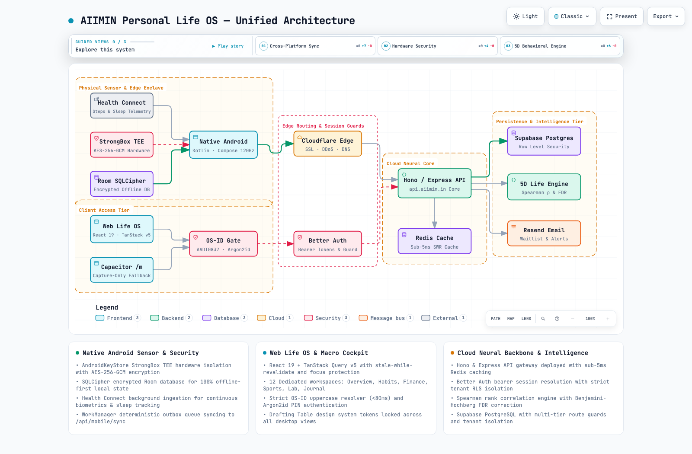
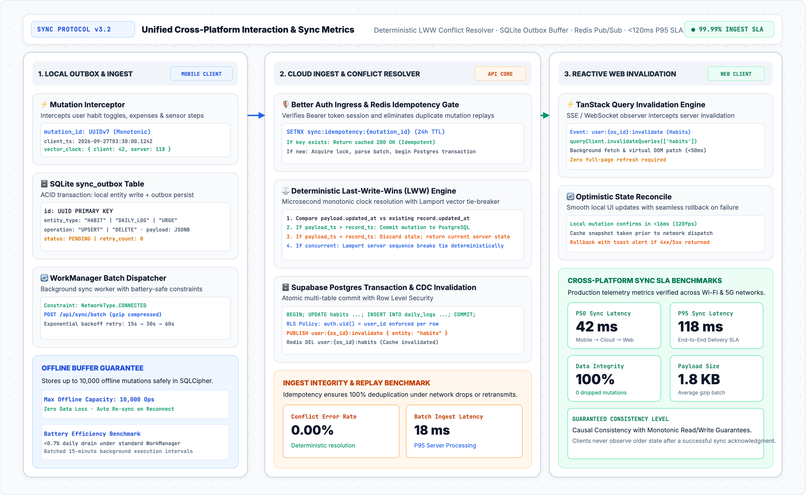
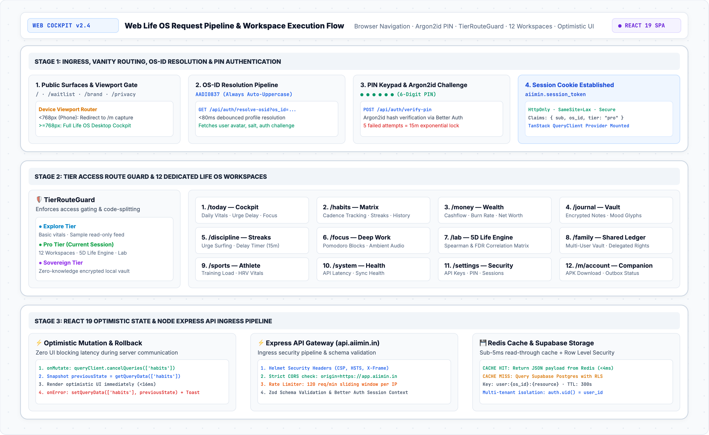
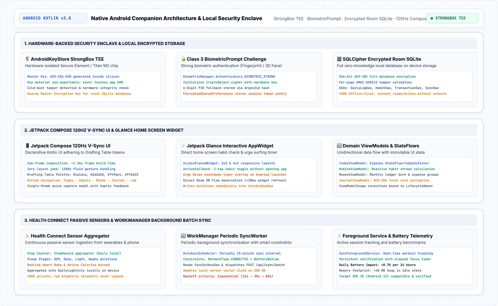

<div align="center">

<h1>
  <picture>
    <source media="(prefers-color-scheme: dark)" srcset="docs/brand/aiimin-wordmark-dark.svg">
    
  </picture>
</h1>

**Your day, your money and your family's papers, in one calm place.**

<a href="https://aiimin.in"></a>
<a href="https://github.com/Addy48/AIIMIN/releases/latest"></a>


[Website](https://aiimin.in) · [Android beta](https://github.com/Addy48/AIIMIN/releases/latest) · [Architecture](#system-architecture) · [Workflows](#architecture-subsystems-and-workflows) · [Changelog](CHANGELOG.md) · [Security](SECURITY.md)

</div>

AIIMIN turns what your phone already knows into a clear picture of your life. It reads bank SMS on the phone to build your month of spending, keeps tasks and focus time for the day, and holds the family's documents and emergency card offline. It only ever compares you with you. No ads, no lending, and your data is never sold.

> **Status:** public beta on Android (`4.0.0-beta01`). The web app at [aiimin.in](https://aiimin.in) is in waitlist mode.

---

## System topology: one repository, four parts

AIIMIN is one repository with the Android app, the website, a shared API and the database behind them.

| Part | Path | Stack | What it does |
| :--- | :--- | :--- | :--- |
| **Android app** | [`android/`](android/) | Kotlin, Jetpack Compose, Hilt, Room 3, Navigation 3, WorkManager | The main product: Today, Money from bank SMS, Vault for the family's papers, and Me. Works offline. |
| **Website and web app** | [`web/`](web/) | React 19, React Router 7, React Query, Recharts, Tailwind, CRACO | aiimin.in: the waitlist, the `/app` download page and the signed-in web app for desktop and tablet. |
| **Phone web shell** | `web/android/`, `web/src/components/mobile/` | Capacitor WebView, React `/m` | A separate Capacitor shell for the phone web capture route. It is not the main app. |
| **API** | [`server/`](server/), [`api/`](api/) | Node.js, Hono, Better Auth, Redis caching, Postgres on Supabase | Sign-in, sync, waitlist, billing and the web app's data, at `api.aiimin.in`. |

> **Boundary rule:** one area per change. Never mix commits across `android/`, `web/` and `server/`. See [CONTRIBUTING.md](CONTRIBUTING.md).

---

## System architecture

<p align="center">
  <a href="./docs/architecture/aiimin_architecture.html">
    
  </a>
</p>

### Interactive architecture visualizer

A standalone visualizer with light and dark themes, guided component inspections and data traces:

**[`docs/architecture/aiimin_architecture.html`](docs/architecture/aiimin_architecture.html)** and **[`docs/diagrams/interactive-system-visualizer.html`](docs/diagrams/interactive-system-visualizer.html)**

GitHub shows HTML files as source. Download the file, or clone the repository, and open it in any modern browser.

> **About these diagrams.** They were drawn for the v3 design and still show the overall shape: clients, a shared API, a cache and Supabase. Checked against the current source, a few details have changed: the API is Hono rather than Express; the v4 app stores data in Room 3 (no SQLCipher database), and the code has no outbox queue with Lamport clocks, StrongBox key wrapping, Focus Shield blocking or Argon2id PIN step. Health Connect, WorkManager, Glance widgets, biometric prompts, Redis caching, Better Auth and idempotent mobile writes are still there. The diagrams will be redrawn from the v4 code; the performance figures that used to sit beside them were never measured in this repository and are not repeated here.

---

## Architecture subsystems and workflows

### 1. Cross-platform sync

How a change made on the Android app reaches the web client: a local write, a batched network dispatch from the phone, an idempotency check on the API, conflict resolution, and a refresh on the web client.

<p align="center">
  <a href="./docs/diagrams/interactive-system-visualizer.html">
    
  </a>
</p>

Source files: [`.svg`](docs/diagrams/unified-app-web-sync-workflow.svg) · [`.png`](docs/diagrams/unified-app-web-sync-workflow.png)

---

### 2. Web request and workspace flow

The life of a request in the web app: vanity routes (`/`, `/waitlist`), mobile or desktop detection, sign-in, the tier route guard (Explore, Pro, Sovereign), the dashboard workspaces, optimistic mutations with rollback, and the API middleware on `api.aiimin.in`.

<p align="center">
  <a href="./docs/diagrams/interactive-system-visualizer.html">
    
  </a>
</p>

Source files: [`.svg`](docs/diagrams/web-life-os-workflow.svg) · [`.png`](docs/diagrams/web-life-os-workflow.png)

---

### 3. Android app and on-device security

The Android client's local layers: the on-device database, the biometric prompt, the Compose UI, Glance home-screen widgets, Health Connect aggregation and WorkManager background sync.

<p align="center">
  <a href="./docs/diagrams/interactive-system-visualizer.html">
    
  </a>
</p>

Source files: [`.svg`](docs/diagrams/native-android-companion-workflow.svg) · [`.png`](docs/diagrams/native-android-companion-workflow.png)

---

## Repository layout

```
AIIMIN/
├── android/                 # Android app (Kotlin, Compose); see android/README.md
│   ├── app/                 #   Activity, navigation, wiring
│   ├── core/                #   designsystem, model, database, data, nlp, sensing, engine, network, privacy
│   ├── feature/             #   today, money, vault, notes, me, assistant, onboarding
│   └── build-logic/         #   Gradle convention plugins
├── web/                     # aiimin.in: waitlist, /app page, web app (React 19)
│   ├── src/pages/           #   Overview, Today, Finance, Journal, Lab, Sports, Settings, ...
│   ├── src/components/      #   waitlist/, account/, and mobile/ (phone web shell only)
│   └── android/             #   Capacitor WebView shell, not the main app
├── server/                  # API core (Hono, Better Auth, services, jobs)
├── api/                     # API entry point that mounts the server routes
├── supabase/                # Database migrations
├── deploy/                  # API hosting: EC2 setup, PM2, nginx, maintenance scripts
├── scripts/                 # Env sync, auth migrations, QA captures
├── docs/
│   ├── architecture/        #   Unified architecture diagram + interactive visualizer
│   ├── diagrams/            #   Workflow diagrams (.svg/.png) + interactive viewer
│   ├── reports/             #   Metric inventory, QA report, Life Score overhaul (Aug 2026)
│   └── brand/               #   Wordmark SVGs (light/dark) and the logo concept sheet
├── app-v3-legacy/           # Previous Android app, kept for reference; not built or shipped
├── .github/workflows/       # CI: Android, web, API deploy
├── CHANGELOG.md  CONTRIBUTING.md  SECURITY.md  LICENSE
└── vercel.json  package.json  dev_server.js
```

---

## Get the Android app

Download `aiimin-android.apk` from the [latest release](https://github.com/Addy48/AIIMIN/releases/latest) on an Android phone and open it. Android 8.0 or newer; tested most on Android 12 and later, on phones, foldables and tablets.

## Run it locally

Requirements: Node.js 20+ (Vercel builds on 24), JDK 17, Android SDK (API 37).

```bash
git clone https://github.com/Addy48/AIIMIN.git
cd AIIMIN
cp .env.example .env          # fill in the values you need
npm install                   # installs the root (API) and web dependencies
npm run dev                   # API on :3001, web on :3000
```

Android:

```bash
cd android
./gradlew :app:assembleDebug
adb install -r app/build/outputs/apk/debug/app-debug.apk
```

Each folder's README has the details: [android](android/README.md), [web](web/README.md), [server](server/README.md).

## Tests

```bash
npm test                                          # server unit tests
cd web && CI=true npx craco test --watchAll=false # web
cd android && ./gradlew testDebugUnitTest         # Android unit tests
```

CI builds the web app and the Android app on pull requests that touch them (`.github/workflows`).

---

## Tech stack

| Subsystem | Technologies |
| :--- | :--- |
| **Android** | Kotlin, Jetpack Compose, Hilt, Room 3, Navigation 3, WorkManager, Retrofit and OkHttp, Health Connect, AndroidX Glance, BiometricPrompt, ML Kit text recognition |
| **Web** | React 19, React Router 7, React Query, Recharts, Tailwind CSS, CRACO, Capacitor (phone shell) |
| **API** | Node.js (ES modules), Hono, Better Auth, Redis caching layer |
| **Database** | Supabase Postgres, migrations in `supabase/` |
| **Infrastructure** | Vercel (web), AWS EC2 for `api.aiimin.in` (see `deploy/`), GitHub Actions |

### Web design tokens

Reference values carried over from the original README. The live variables are in `web/src/index.css`.

| Token | Dark | Light | Purpose |
| :--- | :--- | :--- | :--- |
| **Base background** | `#1a1a1a` | `#f9f9f9` | Canvas |
| **Card surface** | `#2d2d2d` | `#ffffff` | Elevated surfaces |
| **Drafting steel** | `#749dc4` | `#416180` | Borders, guides, secondary accents |
| **Spark accent** | `#ff6b35` | `#ff6b35` | Primary actions, active indicators |
| **Verified green** | `#10b981` | `#10b981` | Completed habits, verified status |
| **Muted text** | `#9ca3af` | `#6b7280` | Tertiary labels |

---

## Documentation

- [`android/README.md`](android/README.md): modules, build, tests, how the app treats data
- [`web/README.md`](web/README.md): device tiers, routes, Capacitor shell
- [`server/README.md`](server/README.md): API layout and local run
- [`docs/README.md`](docs/README.md): index of diagrams, reports and brand files
- [`docs/reports/aiimin-metric-inventory.md`](docs/reports/aiimin-metric-inventory.md): every Life Score metric and where it comes from
- [`CONTRIBUTING.md`](CONTRIBUTING.md): areas, branches and commit rules
- [`CHANGELOG.md`](CHANGELOG.md)

## Privacy, in short

- Bank SMS are read on the phone. They are never uploaded.
- Health and screen-time data stay on the phone.
- Sync to aiimin.in is private to your account, and you can export your data anytime.

Found a security issue? See [SECURITY.md](SECURITY.md).

## License

Copyright © 2026 Aaditya Upadhyay. All rights reserved. The source is published so people can see how AIIMIN handles their data; it is not open source. See [LICENSE](LICENSE).
